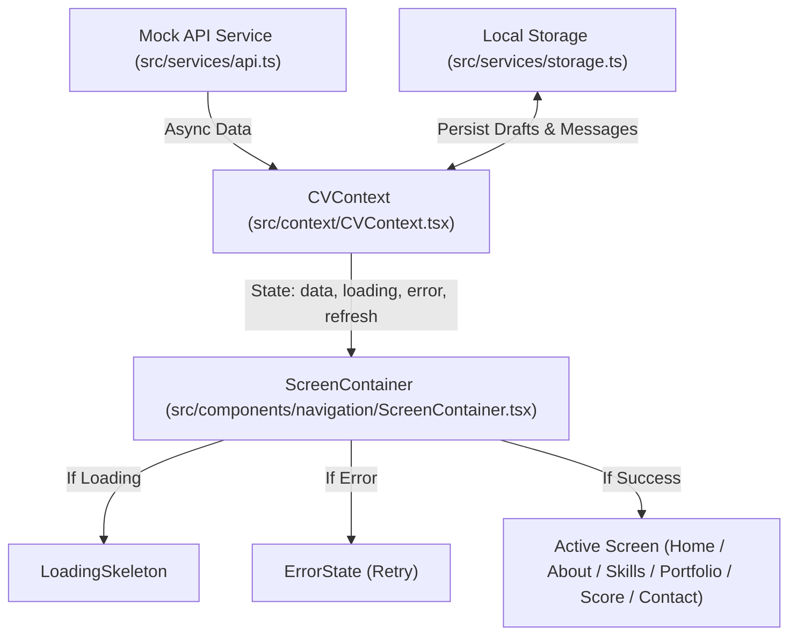

# Technical Architecture Documentation
### Personal CV & Portfolio Application (Level 9–10)
**Dini Asyfa (NIM: 242505008)**

---

## 1. Arsitektur Folder & Tanggung Jawab (Separation of Concerns)

Aplikasi dibangun dengan prinsip **Clean Separation of Concerns**:

```text
src/
├── app/                  # Route screens (Expo Router file-based routing)
│   ├── _layout.tsx       # Root Layout & Context Providers (Theme & CV Data)
│   ├── index.tsx         # Screen 1: Home (Profil Singkat & Directory)
│   ├── about.tsx         # Screen 2: About (Biodata, Pengalaman, Organisasi, Pendidikan)
│   ├── skills.tsx        # Screen 3: Skills (Soft & Technical Skills, Proficiency)
│   ├── portfolio.tsx     # Screen 4: Portfolio (Galeri Proyek, Filter, Search, Favorit)
│   ├── score.tsx         # Screen 5: My Score (Academic Dashboard & Target Simulator)
│   └── contact.tsx       # Screen 6: Contact (Formulir, Validasi, Riwayat Pesan)
│
├── components/           # Reusable UI components
│   ├── navigation/       # Navigation bars (DesktopNavbar & MobileTabBar)
│   │   ├── DesktopNavbar.tsx
│   │   ├── MobileTabBar.tsx
│   │   └── ScreenContainer.tsx
│   ├── common/           # State feedback components
│   │   ├── LoadingSkeleton.tsx
│   │   ├── ErrorState.tsx
│   │   ├── EmptyState.tsx
│   │   └── SearchBar.tsx
│   ├── AboutSection.tsx
│   ├── AcademicDashboard.tsx
│   ├── Barcode.tsx
│   ├── ContactForm.tsx
│   ├── DesktopSlideHero.tsx
│   ├── ExperienceItem.tsx
│   ├── PortfolioCard.tsx
│   ├── ProfileHeader.tsx
│   ├── ProgressItem.tsx
│   └── SectionCard.tsx
│
├── context/              # Global state management
│   ├── ThemeContext.tsx  # Monochrome Light/Dark theme switching
│   └── CVContext.tsx     # Application data, loading, error, and message state
│
├── data/                 # Local data sources / mock payload
│   ├── academic.json
│   ├── portfolio.json
│   └── profile.json
│
├── hooks/                # Custom React hooks
│   └── useResponsive.ts  # Viewport & screen breakpoint detector
│
├── services/             # External integration & side-effects
│   ├── api.ts            # Mock LMS/API client with latency and error simulation
│   └── storage.ts        # Local device persistence adapter
│
├── types/                # TypeScript interfaces and contracts
│   └── index.ts          # Centralized data types
│
└── utils/                # Pure business logic and utilities
    ├── scoreCalculator.ts # Academic formula and simulator
    └── validation.ts     # Input validation functions
```

---

## 2. Alur Data & State Management



---

## 3. Keputusan Teknis Penting

1. **Expo Router untuk Navigasi Multi-Screen (Level 9)**:
   - File-based routing di dalam folder `src/app/` memberikan navigasi yang terstruktur dan mudah diuji.
   - Layar PC menggunakan **Desktop Navbar** tetap di bagian atas dengan indikator aktif, sedangkan layar HP menggunakan **Mobile Tab Bar** tetap di bagian bawah.

2. **Desain Monokrom Hitam-Putih Terpadu**:
   - Skema warna konsisten di seluruh halaman aplikasi, terinspirasi oleh portofolio desain grafis bergaya editorial.
   - Tetap mendukung tema *Dark Mode* elegan yang dapat diubah kapan saja.

3. **Penyediaan Tombol Simulasi Error untuk Demonstrasi (Level 10)**:
   - Tombol "Test Error" disematkan pada navigasi untuk memungkinkan penguji atau dosen melihat secara langsung bagaimana aplikasi menangani kesalahan jaringan dan fungsi tombol "Coba Lagi" (*Retry*).

4. **Kalkulator Target Nilai Akademik (Level 10)**:
   - Fitur inovatif yang menghitung secara matematis target nilai akhir perkuliahan berdasarkan formula bobot nilai berjalan dan nilai UAS.
